# Informe – Laboratorio 5.1: Creación de un Workflow de GitHub Actions para CI

| | |
|---|---|
| **Estudiante** | Jaldin Gonzales Walter |
| **Docente** | Ing. Lucio Marcelo Quispe |
| **Materia** | Trabajando en la Nube |
| **Repositorio** | https://github.com/walterjaldin/ci-productos-api |

---

## 1. Descripción del proyecto

API REST para la gestión de **productos** con operaciones CRUD completas, desarrollada para aplicar Integración Continua (CI) con GitHub Actions.

- **Stack:** Node.js + Express 5 + Jest + Supertest + ESLint
- **Entidad de dominio:** `Producto` (`id`, `nombre`, `precio`, `stock`), almacenada en memoria
- **Pruebas:** unitarias (capa de servicio) y de integración (endpoints HTTP con Supertest)

| Método | Ruta | Descripción |
|---|---|---|
| GET | `/health` | Estado del servicio |
| GET | `/productos` | Lista todos los productos |
| GET | `/productos/:id` | Obtiene un producto (404 si no existe) |
| POST | `/productos` | Crea un producto (400 si los datos son inválidos) |
| PUT | `/productos/:id` | Actualiza un producto |
| DELETE | `/productos/:id` | Elimina un producto |
| GET | `/productos-total` | Cantidad total de productos (agregado vía Pull Request) |

## 2. Pipeline de CI configurado

Archivo `.github/workflows/ci.yml`. Se ejecuta en cada `push` y `pull_request` hacia `main`, con una **matriz de Node.js 22 y 24** en paralelo.

| Requisito de la práctica | Step del workflow |
|---|---|
| Checkout del código | `actions/checkout@v6` |
| Setup del entorno | `actions/setup-node@v6` (con caché de npm) |
| Instalación de dependencias | `npm ci` |
| Compilación / build | `npm run build` (verifica que la app carga sin errores) |
| Linting / análisis estático | `npm run lint` (ESLint) |
| Pruebas unitarias e integración | `npm run test:coverage` |
| Reporte de cobertura | Tabla en el resumen del run + artifact `coverage-node-XX` (umbral mínimo 80 %) |

Además, la rama `main` está protegida: solo acepta cambios mediante Pull Request y exige que los checks `build-and-test (22)` y `build-and-test (24)` pasen antes del *merge*.

---

## 3. Desarrollo paso a paso

### Paso 0: Requisitos

```bash
node -v      # v22 o superior (ESLint 10 requiere Node >= 20.19)
npm -v
git --version
```

### Paso 1: Crear el repositorio en GitHub y clonarlo

1. En GitHub → **New repository**.
2. Configuración:
   - **Repository name:** `ci-productos-api`
   - **Visibility:** **Public**
   - Marcar **Add a README file** (así la rama `main` ya existe).
3. Clic en **Create repository**.

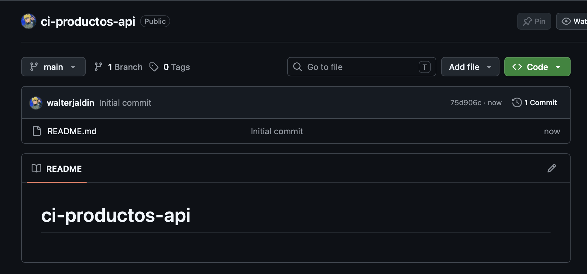
*Figura 1. Repositorio público `ci-productos-api` creado con el README inicial.*

4. Clonar el repositorio y entrar en él:

```bash
git clone https://github.com/walterjaldin/ci-productos-api.git
cd ci-productos-api
```

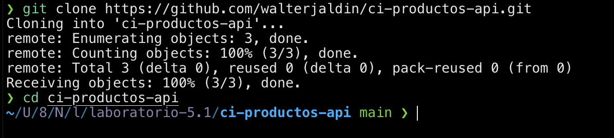
*Figura 2. Clonado del repositorio en la máquina local.*

### Paso 2: Inicializar el proyecto Node.js

```bash
npm init -y
npm install express
npm install --save-dev jest supertest eslint @eslint/js globals
mkdir -p src tests img .github/workflows
```

Archivo `.gitignore`:

```gitignore
node_modules/
coverage/
.env
```

### Paso 3: Código de la API CRUD

#### 3.1 `src/productos.service.js` (lógica de negocio + almacenamiento en memoria)

```javascript
let productos = [];
let nextId = 1;

function validar(data = {}) {
  const errores = [];
  if (typeof data.nombre !== 'string' || data.nombre.trim() === '') {
    errores.push('El nombre es obligatorio');
  }
  if (typeof data.precio !== 'number' || data.precio < 0) {
    errores.push('El precio debe ser un numero mayor o igual a 0');
  }
  if (data.stock !== undefined && (!Number.isInteger(data.stock) || data.stock < 0)) {
    errores.push('El stock debe ser un entero mayor o igual a 0');
  }
  return errores;
}

function listar() {
  return productos;
}

function obtener(id) {
  return productos.find((p) => p.id === id) || null;
}

function crear(data) {
  const nuevo = {
    id: nextId++,
    nombre: data.nombre.trim(),
    precio: data.precio,
    stock: data.stock ?? 0,
  };
  productos.push(nuevo);
  return nuevo;
}

function actualizar(id, data) {
  const index = productos.findIndex((p) => p.id === id);
  if (index === -1) return null;
  productos[index] = {
    id,
    nombre: data.nombre.trim(),
    precio: data.precio,
    stock: data.stock ?? 0,
  };
  return productos[index];
}

function eliminar(id) {
  const index = productos.findIndex((p) => p.id === id);
  if (index === -1) return false;
  productos.splice(index, 1);
  return true;
}

function reset() {
  productos = [];
  nextId = 1;
}

module.exports = { validar, listar, obtener, crear, actualizar, eliminar, reset };
```

#### 3.2 `src/app.js` (rutas Express)

```javascript
const express = require('express');
const service = require('./productos.service');

const app = express();
app.use(express.json());

app.get('/health', (req, res) => {
  res.status(200).json({ status: 'ok' });
});

app.get('/productos', (req, res) => {
  res.status(200).json(service.listar());
});

app.get('/productos/:id', (req, res) => {
  const producto = service.obtener(Number(req.params.id));
  if (!producto) return res.status(404).json({ error: 'Producto no encontrado' });
  res.status(200).json(producto);
});

app.post('/productos', (req, res) => {
  const errores = service.validar(req.body);
  if (errores.length > 0) return res.status(400).json({ errores });
  res.status(201).json(service.crear(req.body));
});

app.put('/productos/:id', (req, res) => {
  const errores = service.validar(req.body);
  if (errores.length > 0) return res.status(400).json({ errores });
  const actualizado = service.actualizar(Number(req.params.id), req.body);
  if (!actualizado) return res.status(404).json({ error: 'Producto no encontrado' });
  res.status(200).json(actualizado);
});

app.delete('/productos/:id', (req, res) => {
  const eliminado = service.eliminar(Number(req.params.id));
  if (!eliminado) return res.status(404).json({ error: 'Producto no encontrado' });
  res.status(204).send();
});

module.exports = app;
```

#### 3.3 `src/server.js` (arranque del servidor)

```javascript
const app = require('./app');

const PORT = process.env.PORT || 3000;

app.listen(PORT, () => {
  console.log(`Servidor escuchando en el puerto ${PORT}`);
});
```

> Se separa `app.js` de `server.js` para que las pruebas puedan importar la app sin levantar el servidor.

### Paso 4: Pruebas unitarias y de integración

#### 4.1 `tests/productos.service.test.js` (unitarias)

```javascript
const service = require('../src/productos.service');

describe('Productos Service (unitarias)', () => {
  beforeEach(() => service.reset());

  test('validar retorna errores si faltan datos', () => {
    const errores = service.validar({});
    expect(errores).toHaveLength(2);
  });

  test('validar rechaza stock negativo', () => {
    const errores = service.validar({ nombre: 'Mouse', precio: 10, stock: -1 });
    expect(errores).toContain('El stock debe ser un entero mayor o igual a 0');
  });

  test('validar acepta un producto correcto', () => {
    expect(service.validar({ nombre: 'Mouse', precio: 10, stock: 5 })).toEqual([]);
  });

  test('crear asigna id incremental y stock por defecto', () => {
    const p1 = service.crear({ nombre: ' Teclado ', precio: 50 });
    const p2 = service.crear({ nombre: 'Monitor', precio: 300, stock: 2 });
    expect(p1).toEqual({ id: 1, nombre: 'Teclado', precio: 50, stock: 0 });
    expect(p2.id).toBe(2);
    expect(service.listar()).toHaveLength(2);
  });

  test('obtener retorna null si no existe', () => {
    expect(service.obtener(99)).toBeNull();
  });

  test('actualizar modifica un producto existente', () => {
    service.crear({ nombre: 'Mouse', precio: 10 });
    const actualizado = service.actualizar(1, { nombre: 'Mouse Gamer', precio: 25, stock: 3 });
    expect(actualizado).toEqual({ id: 1, nombre: 'Mouse Gamer', precio: 25, stock: 3 });
  });

  test('actualizar retorna null si no existe', () => {
    expect(service.actualizar(99, { nombre: 'X', precio: 1 })).toBeNull();
  });

  test('eliminar retorna true/false segun exista', () => {
    service.crear({ nombre: 'Mouse', precio: 10 });
    expect(service.eliminar(1)).toBe(true);
    expect(service.eliminar(1)).toBe(false);
  });
});
```

#### 4.2 `tests/productos.api.test.js` (integración con Supertest)

```javascript
const request = require('supertest');
const app = require('../src/app');
const service = require('../src/productos.service');

describe('API /productos (integracion)', () => {
  beforeEach(() => service.reset());

  test('GET /health retorna ok', async () => {
    const res = await request(app).get('/health');
    expect(res.statusCode).toBe(200);
    expect(res.body.status).toBe('ok');
  });

  test('POST /productos crea un producto', async () => {
    const res = await request(app).post('/productos').send({ nombre: 'Laptop', precio: 1200, stock: 4 });
    expect(res.statusCode).toBe(201);
    expect(res.body).toMatchObject({ id: 1, nombre: 'Laptop' });
  });

  test('POST /productos con datos invalidos retorna 400', async () => {
    const res = await request(app).post('/productos').send({ nombre: '', precio: -5 });
    expect(res.statusCode).toBe(400);
    expect(res.body.errores.length).toBeGreaterThan(0);
  });

  test('GET /productos lista los productos', async () => {
    await request(app).post('/productos').send({ nombre: 'Laptop', precio: 1200 });
    const res = await request(app).get('/productos');
    expect(res.statusCode).toBe(200);
    expect(res.body).toHaveLength(1);
  });

  test('GET /productos/:id retorna el producto o 404', async () => {
    await request(app).post('/productos').send({ nombre: 'Laptop', precio: 1200 });
    expect((await request(app).get('/productos/1')).statusCode).toBe(200);
    expect((await request(app).get('/productos/99')).statusCode).toBe(404);
  });

  test('PUT /productos/:id actualiza, valida y retorna 404', async () => {
    await request(app).post('/productos').send({ nombre: 'Laptop', precio: 1200 });
    const ok = await request(app).put('/productos/1').send({ nombre: 'Laptop Pro', precio: 1500 });
    expect(ok.statusCode).toBe(200);
    expect(ok.body.nombre).toBe('Laptop Pro');
    expect((await request(app).put('/productos/1').send({})).statusCode).toBe(400);
    expect((await request(app).put('/productos/99').send({ nombre: 'X', precio: 1 })).statusCode).toBe(404);
  });

  test('DELETE /productos/:id elimina o retorna 404', async () => {
    await request(app).post('/productos').send({ nombre: 'Laptop', precio: 1200 });
    expect((await request(app).delete('/productos/1')).statusCode).toBe(204);
    expect((await request(app).delete('/productos/1')).statusCode).toBe(404);
  });
});
```

### Paso 5: Linting con ESLint

Archivo `eslint.config.js` en la raíz (formato *flat config*):

```javascript
const js = require('@eslint/js');
const globals = require('globals');

module.exports = [
  { ignores: ['node_modules/', 'coverage/'] },
  js.configs.recommended,
  {
    files: ['**/*.js'],
    languageOptions: {
      ecmaVersion: 'latest',
      sourceType: 'commonjs',
      globals: { ...globals.node, ...globals.jest },
    },
  },
];
```

### Paso 6: Scripts, cobertura y verificación local

`package.json` (sección relevante):

```json
{
  "main": "src/server.js",
  "scripts": {
    "start": "node src/server.js",
    "build": "node -e \"require('./src/app'); console.log('Build OK: la app carga correctamente')\"",
    "lint": "eslint .",
    "test": "jest",
    "test:coverage": "jest --coverage"
  },
  "jest": {
    "testEnvironment": "node",
    "collectCoverageFrom": ["src/**/*.js", "!src/server.js"],
    "coverageReporters": ["text", "lcov", "json-summary"],
    "coverageThreshold": {
      "global": { "statements": 80, "branches": 80, "functions": 80, "lines": 80 }
    }
  }
}
```

| Elemento | Propósito |
|---|---|
| `build` | JavaScript no se compila; este script verifica que la app **carga sin errores** (equivale al paso de *build*). |
| `lint` | Análisis estático con ESLint. |
| `test:coverage` | Ejecuta las pruebas y genera el reporte de cobertura en `coverage/`. |
| `coverageThreshold` | Si la cobertura baja de 80 %, **el pipeline falla**. |
| `json-summary` | Genera `coverage/coverage-summary.json`, usado por el workflow para publicar la tabla de cobertura. |

Ejecución local:

```bash
npm run build
npm run lint
npm run test:coverage
```

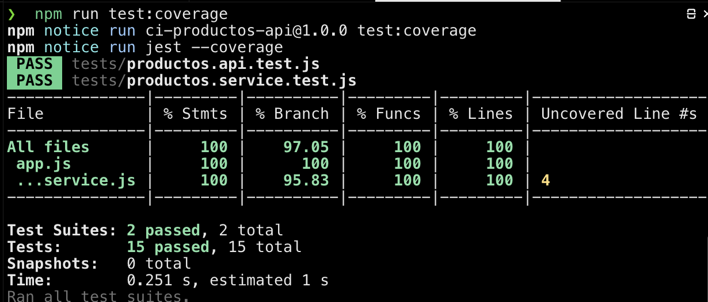
*Figura 3. Las 15 pruebas pasan localmente con 100 % de líneas y 97.05 % de ramas cubiertas.*

Prueba manual de la API:

```bash
npm start
# en otra terminal:
curl -X POST http://localhost:3000/productos -H "Content-Type: application/json" -d '{"nombre":"Laptop","precio":1200,"stock":3}'
curl http://localhost:3000/productos
```

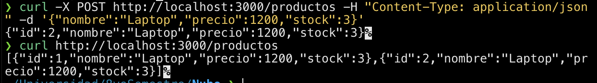
*Figura 4. Creación y listado de productos con `curl`.*

### Paso 7: Workflow de CI completo

`.github/workflows/ci.yml`:

```yaml
name: CI

on:
  push:
    branches: [main]
  pull_request:
    branches: [main]

jobs:
  build-and-test:
    runs-on: ubuntu-latest

    env:
      FORCE_JAVASCRIPT_ACTIONS_TO_NODE24: true

    strategy:
      matrix:
        node-version: [22, 24]

    steps:
      - name: Checkout del codigo
        uses: actions/checkout@v6

      - name: Configurar Node.js ${{ matrix.node-version }}
        uses: actions/setup-node@v6
        with:
          node-version: ${{ matrix.node-version }}
          cache: 'npm'

      - name: Instalar dependencias
        run: npm ci

      - name: Build (verificar que la app carga)
        run: npm run build

      - name: Linting (analisis estatico)
        run: npm run lint

      - name: Pruebas unitarias e integracion con cobertura
        run: npm run test:coverage

      - name: Publicar resumen de cobertura
        run: |
          echo "## Cobertura de codigo (Node ${{ matrix.node-version }})" >> $GITHUB_STEP_SUMMARY
          echo "| Metrica | % |" >> $GITHUB_STEP_SUMMARY
          echo "|---|---|" >> $GITHUB_STEP_SUMMARY
          node -e "const t=require('./coverage/coverage-summary.json').total; for (const k of ['statements','branches','functions','lines']) console.log('| '+k+' | '+t[k].pct+' |')" >> $GITHUB_STEP_SUMMARY

      - name: Subir reporte de cobertura como artifact
        uses: actions/upload-artifact@v5
        with:
          name: coverage-node-${{ matrix.node-version }}
          path: coverage/
```

### Paso 8: Primer push y verificación en Actions

```bash
git add .
git commit -m "API CRUD de productos con pruebas y workflows de CI"
git push origin main
```

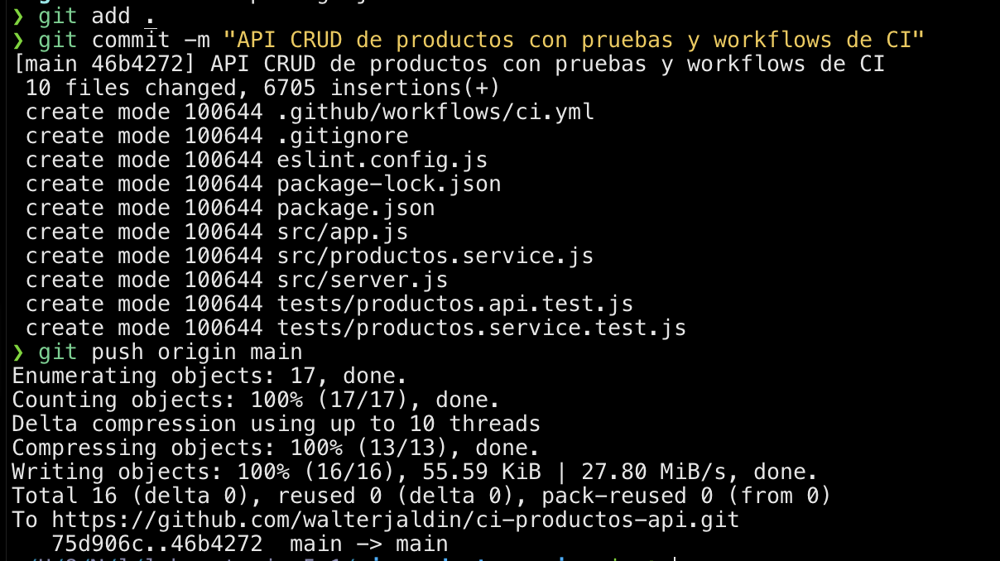
*Figura 5. Commit inicial con el código, las pruebas y el workflow.*

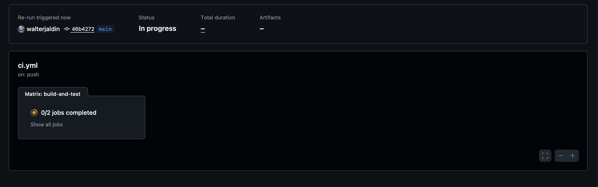
*Figura 6. El workflow se dispara automáticamente con el push (0/2 jobs completados).*

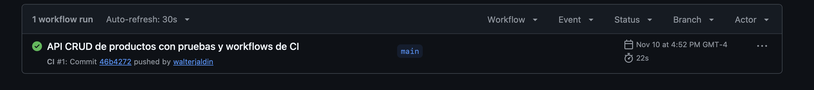
*Figura 7. Ejecución CI #1 completada con éxito en la pestaña Actions.*

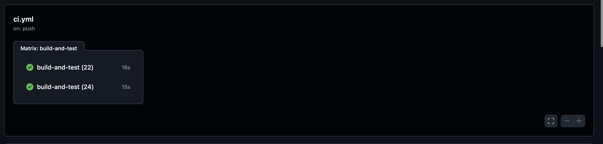
*Figura 8. Los dos jobs de la matriz (Node 22 y Node 24) terminan en verde.*

### Paso 9: Regla de protección de rama en `main`

En **Settings → Branches → Add classic branch protection rule**:

- **Branch name pattern:** `main`
- ✅ **Require a pull request before merging**
- ✅ **Require status checks to pass before merging**
  - ✅ **Require branches to be up to date before merging**
  - Checks requeridos: `build-and-test (22)` y `build-and-test (24)`

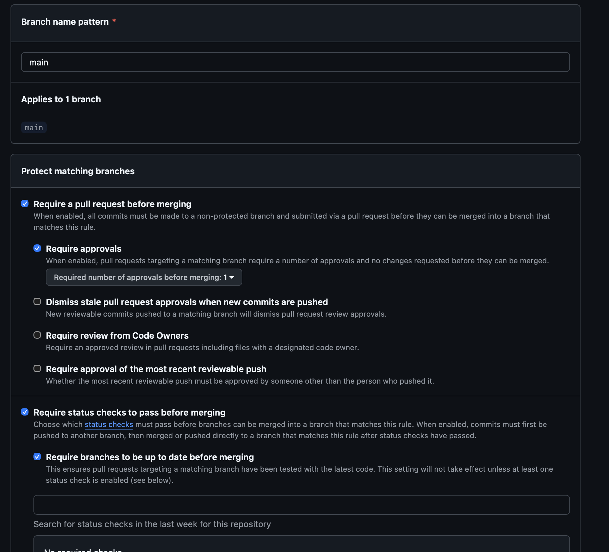
*Figura 9. Configuración de la regla de protección para `main`.*

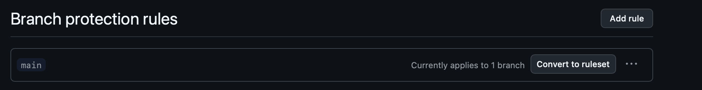
*Figura 10. Regla de protección aplicada a la rama `main`.*

> **Ajuste realizado:** la configuración inicial exigía 1 aprobación de revisión y no tenía checks seleccionados. Como el proyecto es individual (GitHub no permite aprobar el propio PR), se desactivó *Require approvals* y se agregaron los checks `build-and-test (22)` y `build-and-test (24)` como obligatorios (se observan como **Required** en la Figura 17).

### Paso 10: Pull Request con fallo forzado

Se creó la rama `feature/endpoint-total` con un nuevo endpoint que contiene un **error de linting intencional**:

```javascript
app.get('/productos-total', (req, res) => {
  const variableNoUsada = 'esto rompe el linting';
  res.status(200).json({ total: service.listar().length });
});
```

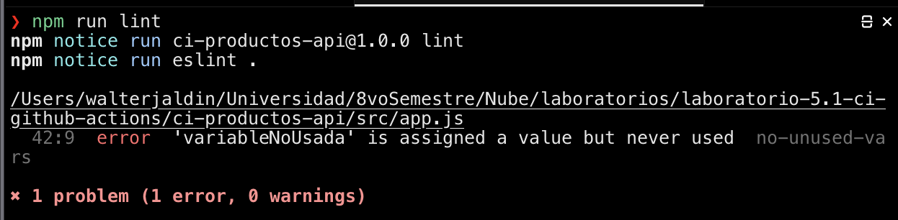
*Figura 11. ESLint detecta localmente la variable no utilizada (`no-unused-vars`).*

```bash
git checkout -b feature/endpoint-total
git add src/app.js
git commit -m "agregamos endpoint de total de productos con error de lint intencional"
git push -u origin feature/endpoint-total
```

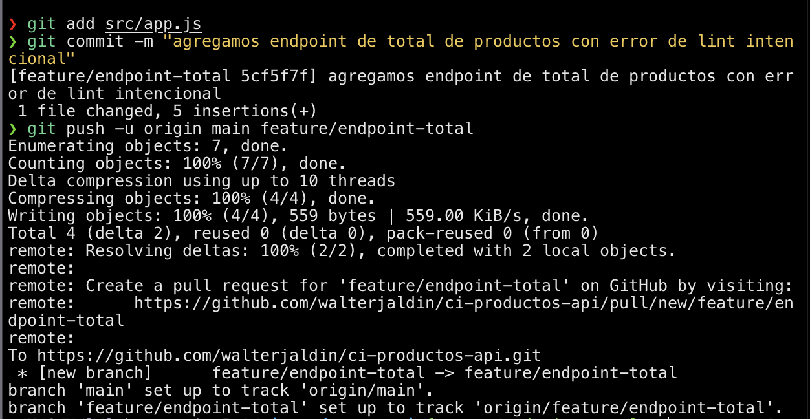
*Figura 12. Push de la rama `feature/endpoint-total` a GitHub.*

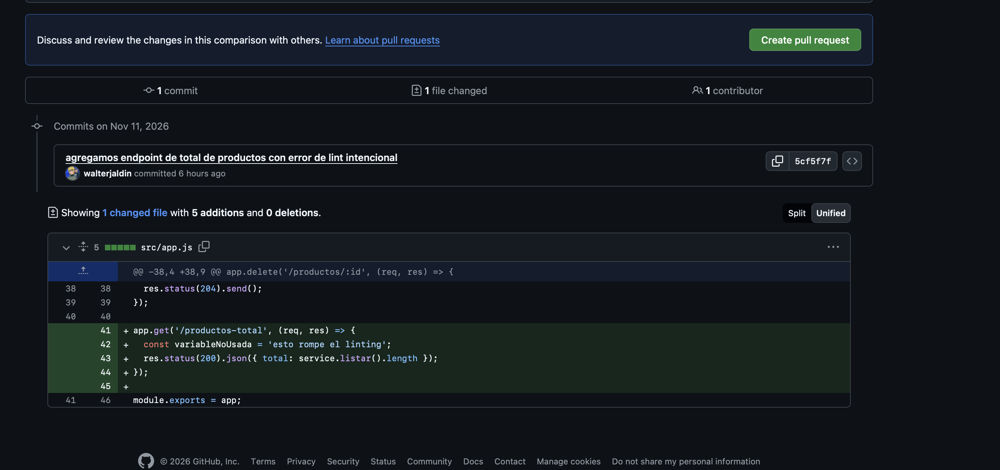
*Figura 13. Creación del Pull Request hacia `main` mostrando el cambio con el error intencional.*

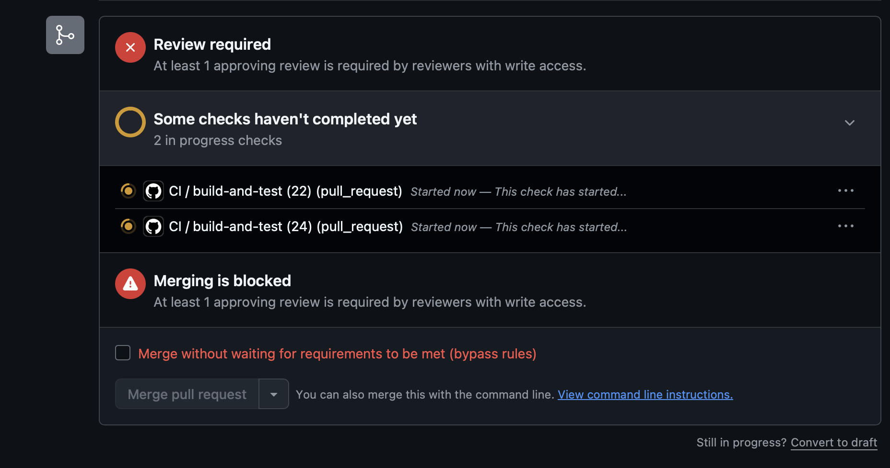
*Figura 14. Al abrir el PR, el CI se ejecuta automáticamente y GitHub bloquea el merge.*

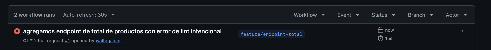
*Figura 15. La ejecución CI #2 del Pull Request #1 falla en el paso de linting.*

### Paso 11: Corregir, pasar el CI y hacer merge

Se eliminó la variable no usada y se agregó una prueba para el nuevo endpoint (para mantener la cobertura):

`src/app.js`:

```javascript
app.get('/productos-total', (req, res) => {
  res.status(200).json({ total: service.listar().length });
});
```

`tests/productos.api.test.js`:

```javascript
  test('GET /productos-total retorna la cantidad de productos', async () => {
    await request(app).post('/productos').send({ nombre: 'Laptop', precio: 1200 });
    const res = await request(app).get('/productos-total');
    expect(res.statusCode).toBe(200);
    expect(res.body.total).toBe(1);
  });
```

```bash
npm run lint && npm run test:coverage
git add src/app.js tests/productos.api.test.js
git commit -m "corregimos error de linting y agrega prueba del endpoint total"
git push
```

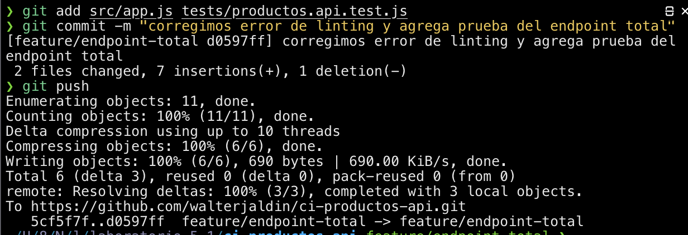
*Figura 16. Push de la corrección a la misma rama; el PR se actualiza solo.*

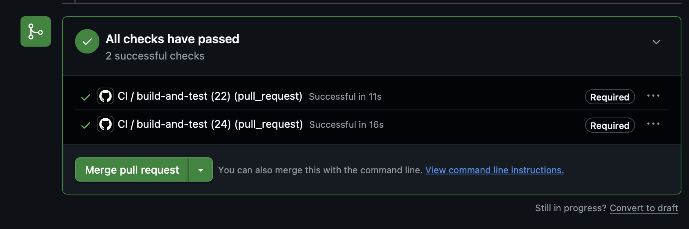
*Figura 17. Ambos checks obligatorios (**Required**) pasan y se habilita el botón de merge.*


*Figura 18. Pull Request fusionado correctamente en `main`.*

Actualización de la copia local:

```bash
git checkout main
git pull
```

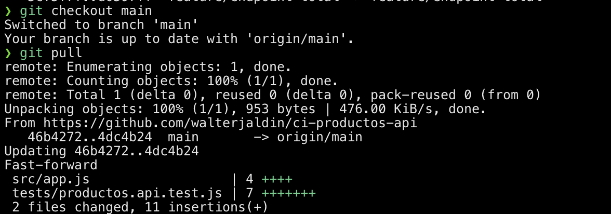
*Figura 19. `main` local actualizada con los cambios fusionados.*

---

## 4. Conclusiones y reflexión

- **Detección temprana de errores:** el pipeline detectó automáticamente el error de linting introducido en el Pull Request, antes de que llegara a `main`. Sin CI, ese error se habría descubierto más tarde y de forma manual.
- **La protección de rama hace cumplir la calidad:** al exigir los checks como obligatorios, no es posible fusionar código que no compila, no pasa el linting o rompe las pruebas. La calidad deja de depender de la disciplina individual.
- **Compatibilidad entre versiones:** la matriz de Node.js 22 y 24 valida en paralelo que la aplicación funcione en ambas versiones sin duplicar configuración.
- **La cobertura como métrica de control:** el umbral del 80 % obliga a acompañar cada nueva funcionalidad con sus pruebas, como se hizo con el endpoint `/productos-total`.
- **Flujo de trabajo profesional:** trabajar con ramas de feature, Pull Requests y checks automáticos reproduce el flujo usado en equipos reales y deja un historial claro de cada cambio.
- **Mejoras futuras:** agregar despliegue continuo (CD), una base de datos real con pruebas de integración en contenedores y publicar la cobertura en un servicio externo.
